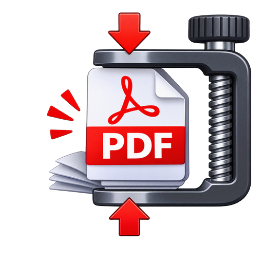

<p align="center">
  
</p>

<h1 align="center">Compresseur PDF</h1>

<p align="center">
  <strong>Allégez vos PDF sans jamais les envoyer sur Internet.</strong><br>
  Application pour Mac et Windows, 100 % locale.
</p>

<p align="center">
  <a href="https://ralba62.github.io/compresseur-pdf/">Page de présentation</a> ·
  <a href="https://github.com/ralba62/compresseur-pdf/releases">Toutes les versions</a>
</p>

<p align="center">
  <a href="https://github.com/ralba62/compresseur-pdf/releases/latest"></a>
  
</p>

---

Compresseur PDF réduit le poids de vos PDF et de vos scans en quelques clics. Tout se passe sur votre ordinateur : **aucune donnée n'est envoyée sur Internet** et aucun compte n'est nécessaire.

- **Un fichier, plusieurs fichiers ou un dossier entier**, sous-dossiers compris (l'arborescence est conservée).
- **Quatre niveaux de compression**, dont un sans aucune recompression des images.
- **Vos originaux ne sont jamais modifiés** : les fichiers compressés gardent le même nom et sont écrits dans un dossier de sortie.
- **Un journal clair** : poids avant, poids après, pourcentage gagné.
- **Un PDF ne devient jamais plus gros** : s'il n'y a rien à gagner, il est copié tel quel.

## Sommaire

- [Télécharger](#télécharger)
- [Premier lancement](#premier-lancement)
- [Utilisation](#utilisation)
- [Questions fréquentes](#questions-fréquentes)
- [Confidentialité et sécurité](#confidentialité-et-sécurité)
- [Lancer depuis le code](#lancer-depuis-le-code)
- [Signaler un problème](#signaler-un-problème)

## Télécharger

Choisissez le fichier qui correspond à votre ordinateur. Les liens pointent toujours vers la dernière version publiée.

| Système | Téléchargement |
|---|---|
| **Mac avec puce Apple** (M1, M2, M3, M4…) — macOS 11 ou plus récent | [`Compresseur-PDF-Mac-Apple-Silicon.zip`](https://github.com/ralba62/compresseur-pdf/releases/latest/download/Compresseur-PDF-Mac-Apple-Silicon.zip) |
| **Mac avec processeur Intel** — macOS 10.13 ou plus récent | [`Compresseur-PDF-Mac-Intel.zip`](https://github.com/ralba62/compresseur-pdf/releases/latest/download/Compresseur-PDF-Mac-Intel.zip) |
| **Windows 10 et 11** (64 bits) | [`Compresseur-PDF-Windows.zip`](https://github.com/ralba62/compresseur-pdf/releases/latest/download/Compresseur-PDF-Windows.zip) |

> **Quel Mac ai-je ?** Cliquez sur le menu Pomme, puis sur « À propos de ce Mac ». Si vous lisez « Puce Apple M… », prenez la version puce Apple. Si vous lisez « Processeur Intel », prenez la version Intel.

Toutes les versions, avec leurs notes, sont sur la page [Releases](https://github.com/ralba62/compresseur-pdf/releases).

## Premier lancement

Les applications ne sont pas signées par Apple ni par Microsoft : ces démarches sont payantes. Au premier lancement, votre système affiche donc un avertissement. Il ne signifie pas que l'application est dangereuse, seulement qu'elle n'a pas été validée par un éditeur référencé. Cette étape ne se fait **qu'une seule fois**.

> Téléchargez l'application uniquement depuis cette page. N'autorisez que cette application : il n'est jamais nécessaire de désactiver les protections de votre ordinateur.

### Sur Mac

1. Double-cliquez sur le fichier `.zip` téléchargé, puis glissez **Compresseur PDF** dans le dossier **Applications**.
2. Double-cliquez sur l'application. Un message apparaît : cliquez sur **Terminé** (pas sur « Placer à la corbeille »).
3. Ouvrez le menu Pomme › **Réglages Système** › **Confidentialité et sécurité**, puis descendez jusqu'à la rubrique **Sécurité**.
4. Cliquez sur **Ouvrir quand même**, saisissez votre mot de passe (ou Touch ID) si on vous le demande, puis confirmez avec **Ouvrir**.

Si le bouton « Ouvrir quand même » n'apparaît pas, refaites l'étape 2 puis revenez dans les Réglages : il n'est proposé que peu de temps après la tentative d'ouverture. Sur un macOS plus ancien (avant Sequoia), un clic droit sur l'application puis **Ouvrir** suffit.

<details>
<summary><strong>Solution de secours avec le Terminal</strong> (si la méthode ci-dessus échoue)</summary>

<br>

Cette commande retire le marqueur « téléchargé depuis Internet » (l'attribut de quarantaine) que macOS appose sur les fichiers téléchargés. Elle ne modifie rien d'autre dans l'application. À réserver à cette application.

1. Ouvrez le **Terminal** (touches `Cmd` + `Espace`, tapez « Terminal », puis `Entrée`).
2. Copiez la ligne ci-dessous, collez-la dans le Terminal, puis appuyez sur `Entrée` (rien ne s'affiche : c'est normal) :

   ```
   xattr -cr "/Applications/Compresseur PDF.app"
   ```

3. Ouvrez l'application par un double-clic.

Si l'application n'est pas dans le dossier Applications : tapez `xattr -cr ` (avec un espace à la fin), glissez l'application dans la fenêtre du Terminal, puis appuyez sur `Entrée`.

</details>

### Sur Windows

1. Faites un clic droit sur le fichier `.zip`, choisissez **Extraire tout…**, puis **Extraire**. Ouvrez le dossier **Compresseur PDF** obtenu.
2. Double-cliquez sur **Compresseur PDF.exe**. Ne le déplacez pas tout seul : il a besoin des fichiers qui sont dans le même dossier.
3. Si la fenêtre bleue « Windows a protégé votre ordinateur » apparaît, cliquez sur **Informations complémentaires**, puis sur **Exécuter quand même**.

Pour le retrouver facilement : clic droit sur `Compresseur PDF.exe`, puis **Envoyer vers** › **Bureau (créer un raccourci)**. Sous Windows 11, cliquez d'abord sur « Afficher plus d'options ».

## Utilisation

La fenêtre est découpée en trois blocs, de haut en bas.

### 1. Choisir les PDF

- **Ajouter des fichiers…** : sélectionnez un ou plusieurs PDF (maintenez `Maj` ou `Ctrl` / `Cmd` pour en choisir plusieurs).
- **Ajouter un dossier…** : tous les PDF du dossier sont ajoutés. La case **Inclure les sous-dossiers**, cochée par défaut, permet de descendre dans les sous-dossiers.
- **Retirer la sélection** et **Vider** permettent de corriger la liste. Un même fichier n'est jamais ajouté deux fois.

### 2. Régler les options

**Compression** : choisissez un niveau. En cas de doute, gardez **Moyen**.

| Niveau | Ce que fait l'application | À choisir pour… |
|---|---|---|
| **Léger** | Images non modifiées. Seule la structure du fichier est optimisée. | Garder la qualité maximale. Gain modeste. |
| **Moyen** *(recommandé)* | Images ramenées à 150 dpi, qualité JPEG 75. | Un usage courant : lecture à l'écran, impression. |
| **Fort** | Images ramenées à 110 dpi, qualité JPEG 60. | L'envoi par e-mail. |
| **Maximum** | Images ramenées à 72 dpi, qualité JPEG 45. | La taille minimale. Les images sont visiblement dégradées. |

**Dossier de sortie** : il est proposé automatiquement.

- Si vous avez ajouté un dossier, c'est un dossier voisin nommé `NomDuDossier_compressé`.
- Si vous avez ajouté des fichiers, c'est un dossier `PDF_compressés` à côté du premier fichier.
- Vous pouvez le changer avec **Parcourir…**. L'application refuse d'écrire dans le dossier des fichiers sources.

Les fichiers compressés gardent **le même nom**, et vos originaux ne sont **jamais modifiés**.

### 3. Lancer la compression

Cliquez sur **Lancer la compression**. La barre de progression avance fichier après fichier, et le journal affiche une ligne par document. À la fin, l'application propose d'ouvrir le dossier de sortie.

| Message du journal | Signification |
|---|---|
| `✔ … 6 image(s) réduite(s) sur 6` | Tout s'est bien passé : les images trouvées ont été allégées. |
| `aucune image trouvée dans ce PDF` | Le PDF ne contient que du texte et des dessins : il y a très peu à gagner. C'est normal. |
| `déjà optimisé, copié tel quel` | La compression n'aurait rien gagné : le fichier est copié à l'identique. |
| `✘ … fichier protégé par mot de passe` | Le PDF demande un mot de passe pour s'ouvrir : il n'est pas traité. |

> **Nos conseils.** Commencez par le niveau *Moyen*, puis ouvrez un des fichiers obtenus pour vérifier qu'il vous convient. S'il est encore trop lourd, essayez *Fort* ; s'il vous semble trop dégradé, reprenez *Léger*. Le gain est important sur les scans en haute résolution, faible sur les PDF de texte.

## Questions fréquentes

<details>
<summary><strong>Mes fichiers sont-ils envoyés sur Internet ?</strong></summary>

Non. La compression se fait entièrement sur votre ordinateur, et l'application fonctionne sans connexion. Vous pouvez le vérifier : coupez votre connexion et lancez une compression.
</details>

<details>
<summary><strong>Le texte de mon PDF est-il abîmé ?</strong></summary>

Non. Seules les images intégrées sont recompressées. Le texte et les dessins ne sont pas dégradés.
</details>

<details>
<summary><strong>Pourquoi mon PDF n'a presque pas changé de taille ?</strong></summary>

Soit il ne contient pas (ou peu) d'images, soit elles étaient déjà bien compressées, soit elles sont d'un type que l'application laisse intact : images en noir et blanc pur, en CMYK, ou avec un masque. Le journal indique ce qui s'est passé pour chaque fichier.
</details>

<details>
<summary><strong>Puis-je compresser un PDF protégé par un mot de passe ?</strong></summary>

Si le PDF demande un mot de passe pour être ouvert, non : l'application l'indique dans le journal et passe au suivant.
</details>

<details>
<summary><strong>Puis-je remplacer l'original par la version compressée ?</strong></summary>

Oui, mais à la main : copiez le fichier compressé à la place de l'original une fois que vous l'avez vérifié. L'application ne le fait jamais à votre place.
</details>

## Confidentialité et sécurité

- **Aucune donnée n'est envoyée sur Internet.** Le code ne contient aucun appel réseau : c'est un programme unique, [`compresseur_pdf.py`](compresseur_pdf.py), que vous pouvez lire.
- **Aucun compte, aucune publicité, aucun suivi.**
- **Les avertissements du premier lancement** viennent de l'absence de signature (Windows) et de notarisation (macOS), pas d'un comportement suspect de l'application. Voir [Premier lancement](#premier-lancement).

## Lancer depuis le code

Le programme est écrit en Python et n'a que deux dépendances : [pypdf](https://pypi.org/project/pypdf/) et [Pillow](https://pypi.org/project/pillow/).

```
pip install -r requirements.txt
python compresseur_pdf.py
```

- Utilisez un Python 3 récent (les applications publiées sont construites avec Python 3.13).
- L'interface utilise Tkinter, inclus avec les installateurs officiels de Python pour Mac et Windows. Sous Linux, installez le paquet `python3-tk`.

## Signaler un problème

Une erreur, une idée, un PDF qui ne se compresse pas comme prévu ? Ouvrez une [issue](https://github.com/ralba62/compresseur-pdf/issues) en précisant votre système (Mac puce Apple, Mac Intel ou Windows), la version de l'application et, si possible, le message affiché dans le journal. Merci de ne **pas** joindre de document confidentiel.
